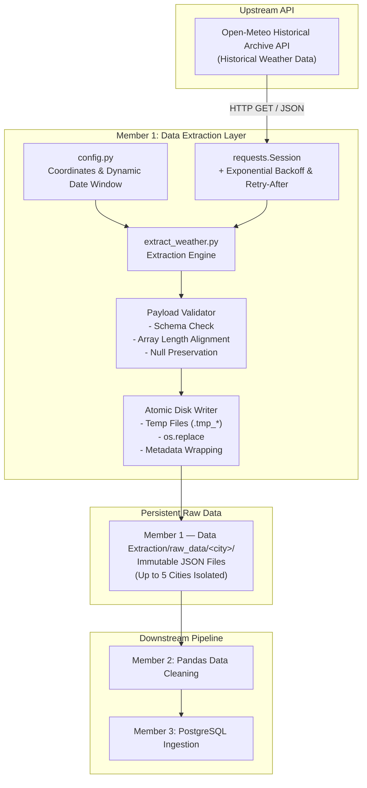

# Weather Data Pipeline with Python and PostgreSQL

A team-based Weather Data Engineering project using Python, with PostgreSQL planned for a later stage. The currently implemented milestone focuses on extracting historical weather data for five Egyptian cities, validating API responses, and storing the raw results as structured JSON files. The broader team plan includes data cleaning, database ingestion, SQL analytics, workflow orchestration, and containerization.

> **Current Implementation:** The completed and documented implementation in this repository is **Member 1 — Data Extraction**. The other stages listed below are planned team work and should not be interpreted as completed functionality.

---

## 👥 Project Team & Responsibility Matrix

This repository is developed by a 6-member engineering team. Each member owns a distinct stage of the data engineering lifecycle:

| Member | Focus Area | Deliverables | Status |
|---|---|---|---|
| **Member 1 (Current)** | **Data Extraction (Backend)** | `Member 1 — Data Extraction/`: extraction code, configuration, raw JSON data, and automated tests | **Implemented** |
| **Member 2** | Data Cleaning & Transformation | Pandas cleansing, outlier treatment, missing value imputation | **Planned** |
| **Member 3** | Database Design & Ingestion | PostgreSQL schema, DDL scripts, batch ingestion engine | **Planned** |
| **Member 4** | Advanced SQL & Analytics | Aggregations, monthly metrics, temperature anomalies | **Planned** |
| **Member 5** | Workflow Orchestration | Apache Airflow DAGs, automated scheduling, SLA alerting | **Planned** |
| **Member 6** | Containerization & DevOps | Docker Compose, environment management, CI/CD pipeline | **Planned** |

---

## 🏛️ Architecture Overview — Extraction Layer

The extraction layer acts as the ingestion backbone, interfacing directly with the Open-Meteo Historical Archive API:



---

## 🚀 Key Features of the Extraction Engine

- **Open-Meteo Archive API Integration:** Retrieves historical weather data from the Open-Meteo Archive API without requiring an API key.
- **Dynamic 30-Day Window with Availability Buffer:** Computes an inclusive 30-day historical range ending five days before the reference date (UTC), using `AVAILABILITY_BUFFER_DAYS = 5`.
- **Request Resilience:**
  - **HTTP 429 Handling:** Parses `Retry-After` headers in both numeric seconds and RFC 7231 HTTP-date formats.
  - **Exponential Backoff:** Retries transient server errors (`500, 502, 503, 504`) and connection timeouts with configurable backoff factor (`initial=1.0s`, `factor=2.0`).
  - **Fail-Fast on Client Errors:** Immediate termination without retries on `4xx` client errors (e.g., `400, 404`).
  - **City Failure Isolation:** Each city is processed in isolation. An extraction or validation failure in one city logs an error but does not abort processing for other cities.
- **Structural Validation:** Enforces parallel array length constraints across all hourly variables (`time`, `temperature_2m`, `relative_humidity_2m`, `precipitation`, `wind_speed_10m`, `weather_code`).
- **Atomic File Storage:** All raw data files are written to temporary files (`.tmp_*`) first and atomically replaced on disk. In case of I/O failure, temporary files are cleanly unlinked, preventing partial or corrupt files.
- **Automated Testing:** 28 unit tests covering extraction retry behavior, storage behavior, and payload validation. The tests use mocks and are designed to run without live API requests.

---

## 📂 Repository Structure

```text
Weather-Data-Pipeline-with-Python-and-PostgreSQL/
├── .gitignore
├── README.md
├── data_contract.md
└── Member 1 — Data Extraction/
    ├── requirements.txt
    ├── config.py
    ├── extract_weather.py
    ├── raw_data/
    │   ├── alexandria/
    │   ├── aswan/
    │   ├── cairo/
    │   ├── mansoura/
    │   └── port_said/
    └── tests/
        ├── test_extraction.py
        ├── test_storage.py
        └── test_validation.py
```

---

## ⚙️ Installation & Setup

### Prerequisites

- **Python:** Version 3.10 or higher (Tested on Python 3.13)
- **Git**

### Step-by-Step Instructions

1. **Clone the repository:**

    ```bash
    git clone https://github.com/usefx007/Weather-Data-Pipeline-with-Python-and-PostgreSQL.git
    cd Weather-Data-Pipeline-with-Python-and-PostgreSQL
    ```

2. **Create and activate a virtual environment:**

    - **Linux / macOS:**

      ```bash
      python3 -m venv .venv
      source .venv/bin/activate
      ```

    - **Windows (PowerShell):**

      ```powershell
      python -m venv .venv
      .\.venv\Scripts\Activate.ps1
      ```

      *(If script execution is disabled on Windows, use `.\.venv\Scripts\python.exe` directly.)*

3. **Install dependencies:**

    ```bash
    pip install -r "Member 1 — Data Extraction/requirements.txt"
    ```

---

## 🏃 Running the Data Extraction

To extract historical weather data for all 5 Egyptian cities (Cairo, Alexandria, Mansoura, Aswan, Port Said):

```bash
python "Member 1 — Data Extraction/extract_weather.py"
```

### Execution Output & Failure Isolation

- **Raw Data Output:** JSON files are saved under `Member 1 — Data Extraction/raw_data/<city_key>/` for each successfully processed city (up to 5 cities per full batch run).
- **Failure Isolation:** Because city failure isolation is enforced, a network or validation failure for one city does not prevent the pipeline from completing and saving data for the remaining cities.
- **Logs:** Real-time progress is printed to standard output and logged to `Member 1 — Data Extraction/logs/extraction.log`.
- **Exit Code:** Returns `0` if all target cities succeeded, or `1` if one or more cities experienced an unrecoverable failure.

---

## 🧪 Running Automated Tests

All tests run completely offline using `pytest` and mock objects (`unittest.mock` and `monkeypatch`).

### Run the full test suite

From the repository root, enter the Member 1 directory:

```bash
cd "Member 1 — Data Extraction"
pytest -v
```

### Run specific test suites

Run these commands from the `Member 1 — Data Extraction` directory:

```bash
# Test extraction resilience and retry policies
pytest -v tests/test_extraction.py

# Test payload schema and array validation
pytest -v tests/test_validation.py

# Test atomic file writes and error cleanup
pytest -v tests/test_storage.py
```

### Expected Test Results

```text
============================= 28 passed ==============================
```

---

## 📜 Data Contract & Downstream Handover

Downstream consumers (**Member 2** and **Member 3**) should review [`data_contract.md`](./data_contract.md) for detailed specifications on:

- Envelope metadata schema (`metadata`)
- Hourly array types and physical units
- Missing value policies (legitimate upstream `null` values are preserved)
- WMO weather codes reference mapping
- Suggested PostgreSQL staging table DDL

---

## 📄 License

This project is developed for educational purposes as part of a University Data Engineering curriculum.
